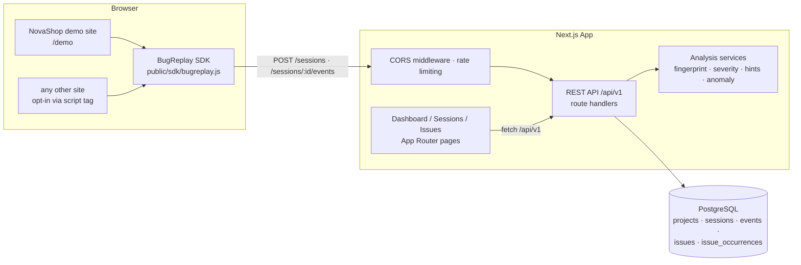

# BugReplay — the time machine for software bugs

BugReplay is a browser-session debugging and error-investigation platform.
When a bug report says “the login button does not work”, BugReplay gives you
the **actions, timing, JavaScript error, and network evidence** to
reproduce it: captured session timelines, fingerprint-grouped issues,
evidence-based diagnostic hints, and exportable bug reports.

> **Platform note.** This product was specified with a Python/FastAPI
> backend. The hosting environment for this deliverable runs a
> **Next.js 16 (App Router) + PostgreSQL (Drizzle ORM)** stack, so the entire
> application is implemented there — same product, same workflow, same API
> surface — in **plain JavaScript** (no TypeScript). The API contract
> (`/api/v1/...`), data model, SDK, and analysis rules match the spec.

---

## 1. Product overview

- Record privacy-conscious browser sessions from any site via a small SDK.
- Inspect every session as a chronological **event timeline** with
  play/pause/step controls (event-based replay — not pixel-perfect playback).
- Errors are **fingerprinted** (normalized message + top stack frames) and
  grouped into **issues** with occurrence + affected-session tracking.
- **Diagnostic suggestions** are rule-based, labelled as hypotheses, and each
  cites the evidence that triggered it.
- **Anomaly score** per session (deterministic, rules-based).
- Export **JSON or Markdown bug reports** with reproduction steps derived
  from real captured events.
- A controlled **demo site** (`/demo`) that generates real events through
  the real SDK → API → PostgreSQL pipeline.

## 2. Problem statement

Vague bug reports lack evidence. Reproduction requires the exact clicks,
navigation, JS error (with stack), and failing network calls — none of which
are usually captured. BugReplay closes that gap with privacy-conscious
instrumentation and an investigation workflow.

## 3. Feature list

| Area | Status |
| --- | --- |
| Session lifecycle (create/start/end) via REST + SDK | ✅ implemented & tested |
| Event ingestion (validated, bounded, idempotent batches) | ✅ implemented & tested |
| SDK: clicks, navigation, window errors, promise rejections, console.error, failed fetches, custom events, stop/start | ✅ implemented & smoke-tested via API |
| Fingerprinting + issue aggregation (counts, affected sessions, severity escalation) | ✅ implemented & tested |
| Diagnostic hints with evidence | ✅ implemented & tested |
| Anomaly scoring (deterministic) | ✅ implemented & tested |
| Dashboard with live stats + 14-day error trend | ✅ implemented |
| Sessions list (search, filters, pagination) + replay timeline | ✅ implemented |
| Issues list (search, severity/status filters, sorting) + detail | ✅ implemented |
| JSON + Markdown report export | ✅ implemented & tested |
| Demo seed (idempotent) + gated demo reset | ✅ implemented & tested |
| Ingestion rate limiting (in-memory, MVP-level) | ✅ implemented |
| CORS restricted to `BUGREPLAY_CORS_ORIGINS` | ✅ implemented |
| Project API keys / authentication | ❌ not implemented — **unauthenticated demo, do not expose publicly** |
| XHR interception | ❌ not implemented (fetch only) — documented limitation |
| Retention policy enforcement | ❌ not implemented — documented limitation |
| Pixel-perfect playback | ❌ out of scope by design |

## 4. Architecture



## 5. Technology stack

- **Next.js 16 (App Router), React 19, plain JavaScript (JS/JSX)** — no TypeScript
- **PostgreSQL** via **Drizzle ORM** (node-postgres driver)
- **Tailwind CSS v4** for styling, **Recharts** for charts, **Lucide** icons
- **Browser SDK**: dependency-free vanilla JS served from `/sdk/bugreplay.js`
- **Self-tests**: `node scripts/selftest.mjs` (pure-logic unit checks)

## 6. Repository structure

```
├── src/
│   ├── app/
│   │   ├── page.js                  # dashboard (live stats, trend, tables)
│   │   ├── sessions/                # list + [id] replay timeline
│   │   ├── issues/                  # list + [id] detail / report
│   │   ├── settings/page.js         # SDK install + privacy + limitations
│   │   ├── demo/page.js             # NovaShop — monitored demo site
│   │   └── api/
│   │       ├── health/route.js
│   │       └── v1/
│   │           ├── health · stats · demo/{seed,reset,fail,slow,ok}
│   │           ├── sessions/…       # list, create, detail, events (GET/POST)
│   │           └── issues/…         # list, detail, PATCH, report(.md)
│   ├── components/                  # AppShell, badges, ui, TrendChart
│   ├── db/                          # schema.js + client (Drizzle)
│   ├── lib/
│   │   ├── analysis.js              # normalization, severity, hints, anomaly
│   │   ├── fingerprint.js           # sha256 fingerprinting, classification
│   │   ├── pipeline.js              # validation + ingestion + aggregation
│   │   ├── seed.js                  # deterministic demo dataset
│   │   ├── report.js                # JSON/Markdown report builders
│   │   ├── sanitize.js              # URL/stack/payload privacy filters
│   │   ├── client.js                # browser API client
│   │   └── useApi.js                # data-fetch hook
│   └── middleware.js                # CORS for /api (BUGREPLAY_CORS_ORIGINS)
├── public/sdk/bugreplay.js          # the browser SDK
├── scripts/selftest.mjs             # automated self-tests
├── docs/                            # architecture · api · testing
└── drizzle.config.json              # schema push config
```

## 7. Prerequisites

- Node.js 20+
- PostgreSQL 13+ reachable at `DATABASE_URL`

## 8. Installation

```bash
npm install
```

## 9–10. Running the app

```bash
# apply schema (idempotent)
npx drizzle-kit push

# production
npm run build && npm run start
# …or development
npm run dev
```

- Dashboard: **http://localhost:3000**
- Demo site: **http://localhost:3000/demo**
- Health: **http://localhost:3000/api/health**

There is **no separate backend process** — the REST API is served by the
same Next.js app under `/api/v1`.

## 11. Configuring the SDK on your site

```html
<script src="http://localhost:3000/sdk/bugreplay.js"></script>
<script>
  BugReplay.init({
    endpoint: "http://localhost:3000",
    projectId: "demo-project",
    environment: "development",
  });
</script>
```

- `BugReplay.track("name", { safe: "payload" })` — custom events
- `BugReplay.stop()` / `BugReplay.start()` — stop / resume recording
- `BugReplay.getStatus()` — live SDK status
- `BugReplay.onEvent(cb)` — observe events as they are captured
- Exclude elements: add `data-bugreplay-exclude` to any element/subtree

## 12. Triggering demo errors

Open **/demo**, then use the “Break it on purpose” panel:

| Button | What it produces |
| --- | --- |
| Trigger JavaScript error | uncaught `TypeError: Cannot read properties of undefined (reading 'customerName')` |
| Trigger failing API request | real `HTTP 500` from `/api/v1/demo/fail?status=500` |
| Trigger network timeout | real timeout (client aborts `/api/v1/demo/slow` at 2.5 s) |
| Log a console error | `console.error` capture |
| Send a custom event | `checkout_started` custom event |

## 13. Loading demo data

Dashboard → **Load demo data** (calls `POST /api/v1/demo/seed`, idempotent).
`POST /api/v1/demo/reset` wipes demo-project data (disabled when
`BUGREPLAY_ENV=production`).

## 14. Running tests

```bash
node scripts/selftest.mjs   # 32 checks over fingerprinting, severity, hints,
                            # anomaly scoring, and privacy sanitizers
```

## 15. Playwright / E2E

This environment cannot run headless browsers, so no Playwright suite is
shipped. Instead, the full pipeline was verified with **live HTTP E2E
smoke tests** against the running production build (session creation →
ingestion → aggregation → report download → status transitions), all
passing — see `docs/testing.md` for the recorded results.

## 16. Environment variables

| Variable | Required | Description |
| --- | --- | --- |
| `DATABASE_URL` | yes | PostgreSQL connection string |
| `BUGREPLAY_CORS_ORIGINS` | no | Comma-separated origins allowed to ingest cross-origin. **No wildcard.** |
| `BUGREPLAY_ENV` | no | Set `production` to disable the destructive demo reset |

## 17. API endpoints

| Method | Path | Purpose |
| --- | --- | --- |
| GET | `/api/health` · `/api/v1/health` | service + DB health |
| GET | `/api/v1/stats` | dashboard aggregates + 14-day error trend |
| GET | `/api/v1/sessions` | list (q, environment, errors, from/to, page, pageSize≤100) |
| POST | `/api/v1/sessions` | create a session |
| GET | `/api/v1/sessions/:id` | metadata + anomaly score + linked issues |
| GET | `/api/v1/sessions/:id/events` | ordered events (pageSize≤500) with linked issues |
| POST | `/api/v1/sessions/:id/events` | ingest 1–50 validated events (idempotent keys) |
| GET | `/api/v1/issues` | list (q, severity, status, sort, pagination) |
| GET | `/api/v1/issues/:id` | detail: occurrences, evidence, repro steps, hints |
| PATCH | `/api/v1/issues/:id` | status transition (validated state machine) |
| GET | `/api/v1/issues/:id/report` | structured JSON report |
| GET | `/api/v1/issues/:id/report.md` | downloadable Markdown report |
| POST | `/api/v1/demo/seed` | idempotent demo dataset |
| POST | `/api/v1/demo/reset` | delete demo data (gated) |
| GET | `/api/v1/demo/fail?status=` · `slow` · `ok` | controlled endpoints for the demo |

Full details in `docs/api.md`.

## 18. Database

PostgreSQL; schema in `src/db/schema.js`, applied with
`npx drizzle-kit push` (creates tables automatically, idempotent).
Tables: `projects`, `sessions`, `events`, `issues`, `issue_occurrences`,
with indexes on timestamps, session IDs, fingerprints, and issue status,
and a unique `(project_id, fingerprint)` constraint so repeated errors
**update** an issue instead of duplicating it.

## 19. Privacy & security

- The SDK never captures form values, password fields, cookies, auth
  headers, request/response bodies, keystrokes, sensitive query params, or
  fragments. Clicks are reduced to tag + safe selector + button label.
- The server re-scrubs payloads (sensitive keys → `[redacted]`), enforces
  payload (8 KB) and batch (50 event) limits, and validates every field.
- CORS is restricted to configured origins; ingestion is rate-limited
  (in-memory, MVP-level).
- **This build is unauthenticated.** Never expose it publicly with real
  data. This is a privacy-aware design, not a GDPR/CCPA compliance claim.

## 20. Limitations & roadmap

- No authentication/API keys on ingestion (documented, gated demo only).
- No XHR interception (fetch only).
- In-memory rate limiting does not survive restarts/multi-worker deploys.
- No retention enforcement; no pixel-perfect playback; severity/anomaly
  scores are heuristics, not measured business impact.
- Roadmap: project API keys, XHR wrapper, Postgres-based rate limiting,
  retention jobs, optional Isolation-Forest anomaly model on synthetic data.

## 21. Deployment

Any static+Node host that runs `npm run build && npm run start` (Vercel,
Render, a plain Node box…). Set `DATABASE_URL` (managed Postgres),
`BUGREPLAY_CORS_ORIGINS` for cross-origin SDK use, and
`BUGREPLAY_ENV=production`. The repo includes a `docker-compose.yml`
sketch for local Postgres + app. Nothing here is deployed yet — this
sandbox preview is the only running instance.

## 22. Screenshots

Add genuine screenshots after running the product:

1. Open the dashboard → capture to `docs/screenshots/dashboard.png`
2. Session replay → `docs/screenshots/replay.png`
3. Issue detail → `docs/screenshots/issue.png`

Then embed them here: ``.

## GitHub publishing checklist

- [ ] `git init` · `git add -A` · commit (`.gitignore` excludes
      `node_modules`, `.next`, `*.db`, `.env`)
- [ ] Replace this README's platform note with your target stack's
      instructions if you port it
- [ ] Run `node scripts/selftest.mjs` in CI
- [ ] Tag a release and attach the sample Markdown report from
      `/issues/:id/report.md`
# BUG-REPLAY

